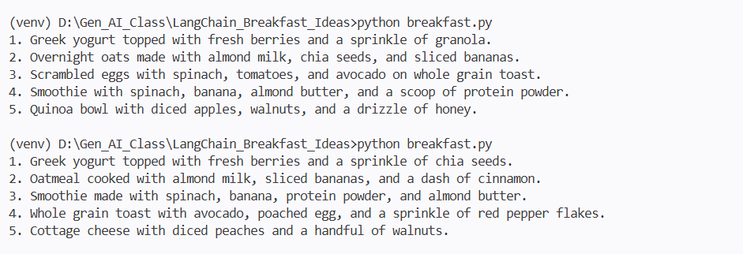

# LangChain Breakfast Ideas Generator

A short LangChain script that asks an OpenAI chat model for five breakfast ideas.

> Part of my Gen AI course practice work (Week 2, Day 5).

## Tech stack

- Python 3
- LangChain
- OpenAI (`gpt-4o-mini`)

## Features

- Loads the API key from `.env`
- Calls ChatOpenAI at temperature 0.7
- Screenshot comparing two runs

## Getting started

1. Clone the repository:
   ```bash
   git clone https://github.com/Prembazskar/langchain-breakfast-ideas-generator.git
   cd langchain-breakfast-ideas-generator
   ```
2. Install and configure:
   ```bash
   pip install -r requirements.txt
   cp .env.example .env   # then add your OpenAI key
   ```

Environment variables (set in `.env`, never commit it):

- `OPENAI_API_KEY`

## Usage

```bash
python breakfast.py
```

## Screenshots



## License

MIT, see [LICENSE](LICENSE).
